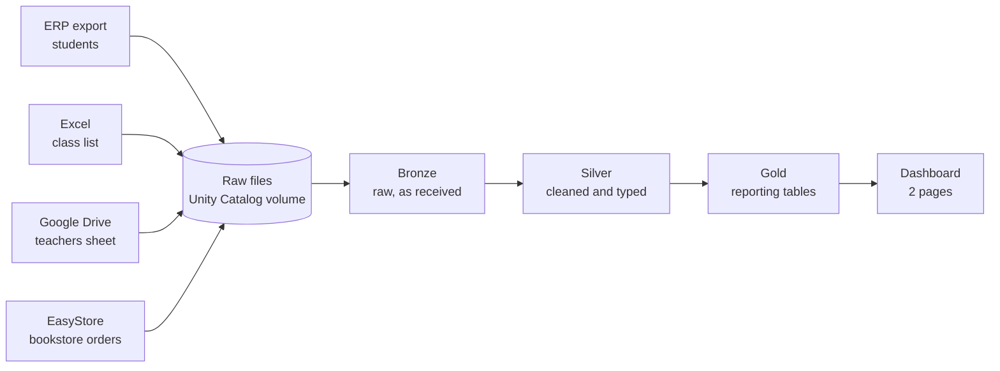
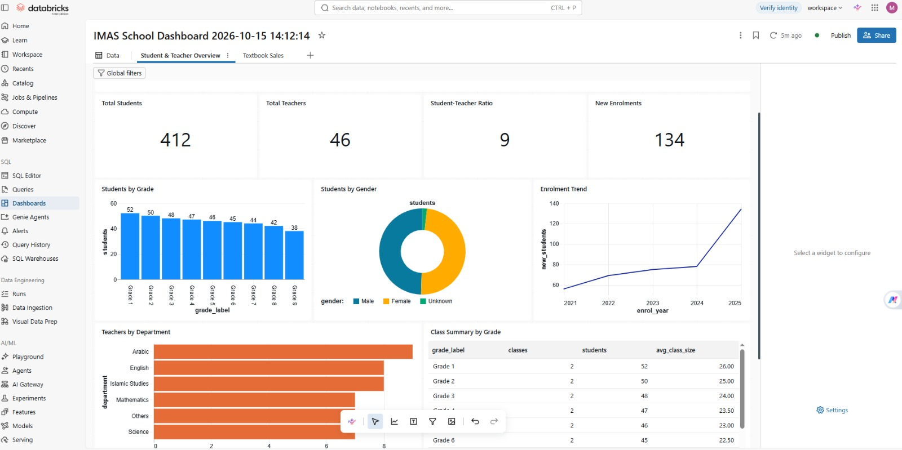
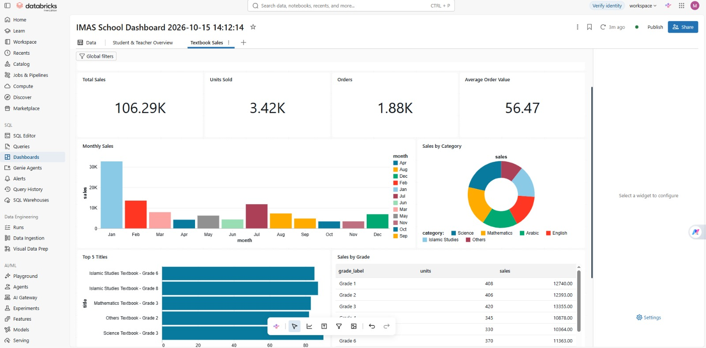

# School Data Platform: Medallion Pipeline on Databricks

An end-to-end data engineering project that turns messy, multi-source school data into a clean, governed analytics layer and a published dashboard. It follows the **Bronze, Silver, Gold (medallion)** architecture and is built on **Databricks**, **Python/Pandas** and **SQL**.

> **Important:** all data in this project is **synthetic**. Real school records are confidential, so I built this from scratch on generated data. It recreates the shape of the real data flow (sources, problems and reporting goals) without containing any real student, teacher or sales information.

  

## Why I built this

I work with data from several systems in a school environment: an ERP export, Excel files, shared spreadsheets and an online bookstore. Reports were assembled by hand, which invites inconsistencies. I built this project to show how I would process that data properly: preserve the raw data, apply explicit cleaning rules, build reporting tables, and serve a dashboard. It is also my way of testing that my skills match real data engineering work.

## Architecture



| Layer | Purpose | Tables |
|---|---|---|
| **Bronze** | Load files exactly as received. All columns are text, plus lineage columns `source_file` and `ingested_at`. | `bronze_students`, `bronze_classes`, `bronze_teachers`, `bronze_sales` |
| **Silver** | Standardise, type, validate and deduplicate using Python/Pandas. | `silver_students`, `silver_teachers`, `silver_sales` |
| **Gold** | Business-ready aggregates built with SQL, one table per dashboard visual. | 11 tables, for example `gold_kpi_overview`, `gold_students_by_grade`, `gold_sales_monthly` |

## The synthetic data (and its deliberate problems)

A notebook generates four source files with fixed seeds, so results are reproducible. Each file is intentionally messy, like real exports:

| Source (simulated) | File | Volume | Problems injected |
|---|---|---|---|
| ERP student master | `erp_students.csv` | 412 students plus 15 duplicate rows | Grade written as "Grade 3", "G3", "Gred 3"; mixed date formats; about 2% blank gender; duplicate rows with different casing and spacing |
| Excel class allocation | `excel_class_list.csv` | 1 row per student | Class names to join back to students |
| Google Drive teacher sheet | `gdrive_teachers.csv` | 46 teachers | Department written in different cases and with extra spaces |
| EasyStore orders | `easystore_orders.csv` | 1,904 orders plus 12 duplicates | Prices stored as "35.00" or "RM 35.00"; about 1% missing quantity; duplicate orders |

## Silver layer: data quality rules

| Rule | Implementation |
|---|---|
| Standardise names | `strip()` and `title()` |
| Extract grade number | Regular expression `(\d+)` on the raw grade label |
| Normalise gender | Mapping dictionary, blanks become `Unknown` instead of being dropped |
| Parse mixed date formats | `pd.to_datetime(..., format="mixed", errors="coerce")` so bad dates become null instead of failing the job |
| One row per student / order | `drop_duplicates` on `student_id` / `order_id` |
| Remove orders with no quantity | Filter on null quantity (documented rule) |
| Clean price text | Strip "RM", cast to float |
| Derive revenue | `qty * unit_price`, rounded to 2 decimals |
| Join class to student | Left join, so students without a class are kept |

The notebook prints how many rows each step removed, so every rule has a visible effect.

## Gold layer and dashboard

Gold tables are created with `CREATE OR REPLACE TABLE ... AS SELECT`, so they can be rebuilt at any time. The dashboard reads **only** Gold tables. No cleaning or heavy logic happens in the visuals.

**Page 1: Student & Teacher Overview.** KPI counters (students, teachers, student-teacher ratio, new enrolments), students by grade, gender split, enrolment trend, teachers by department and a class summary table.

<!-- Add your screenshots to docs/ and update these paths -->


**Page 2: Textbook Sales.** KPI counters (total sales, units, orders, average order value), monthly sales, sales by category, top 5 titles and sales by grade.



## Tech stack

- **Platform:** Databricks Free Edition (serverless compute), Unity Catalog (schema and volume), Delta tables
- **Languages:** Python (Pandas, PySpark for ingestion), SQL
- **Visualisation:** Databricks dashboards
- **Version control:** Git and GitHub, using Databricks Git folders

## How to run it

1. Create a free [Databricks Free Edition](https://www.databricks.com/learn/free-edition) workspace.
2. Clone this repo into a Databricks Git folder, or import `notebooks/medallion_demo.py` as a notebook.
3. Check `CATALOG` at the top of the notebook (Free Edition usually uses `workspace`).
4. Run the notebook from top to bottom. It generates the data, then builds Bronze, Silver and Gold.
5. Create a dashboard, add the `gold_*` tables as datasets, and build the visuals.

## Repository structure

```
.
├── notebooks/
│   └── medallion_demo.py     # data generation, Bronze, Silver, Gold
├── docs/                     # dashboard screenshots
├── .gitignore
└── README.md
```

## Design decisions

- **Raw layer kept as text.** Nothing is silently changed or lost on load, and I can reprocess from Bronze if a rule is wrong.
- **Rules are explicit.** Every cleaning rule is a visible line of code, and its effect is counted.
- **Unknown instead of deleting.** Missing values stay visible instead of disappearing.
- **Rebuildable tables.** Overwrite and `CREATE OR REPLACE` make the pipeline easy to re-run and test.
- **Business logic lives in Gold.** Definitions are in one place and the dashboard stays simple.

## Limitations and planned improvements

These are my planned next steps, not completed work:

- [ ] Rewrite Silver in PySpark instead of `toPandas()`, so it runs distributed
- [ ] Incremental loads with Auto Loader and `MERGE INTO` instead of full overwrites
- [ ] Orchestrate Bronze, Silver and Gold as a Databricks Workflow with failure alerts
- [ ] Automated data quality checks: row count reconciliation, null and uniqueness tests
- [ ] Unity Catalog permissions and masking of personal fields
- [ ] Star schema (fact and dimension tables) for the Gold layer
- [ ] Explore connecting Power BI to the Gold tables
- [ ] Data dictionary and lineage diagram

## Skills demonstrated

Medallion architecture, ETL/ELT design, data cleaning and validation, Python/Pandas, SQL aggregation, Delta tables, Unity Catalog basics, dashboard design, Git workflow, and documentation.

## Author

**Muhammad Fahmie bin Basri**
Network and infrastructure professional moving into data engineering. AWS Certified Solutions Architect – Associate, CompTIA Network+.
[LinkedIn](https://linkedin.com/in/muhammad-fahmie-bin-basri-899a592a5)

## Disclaimer

This is a personal learning and portfolio project using entirely synthetic data. It is not affiliated with, endorsed by, or a copy of any organisation's production system.
